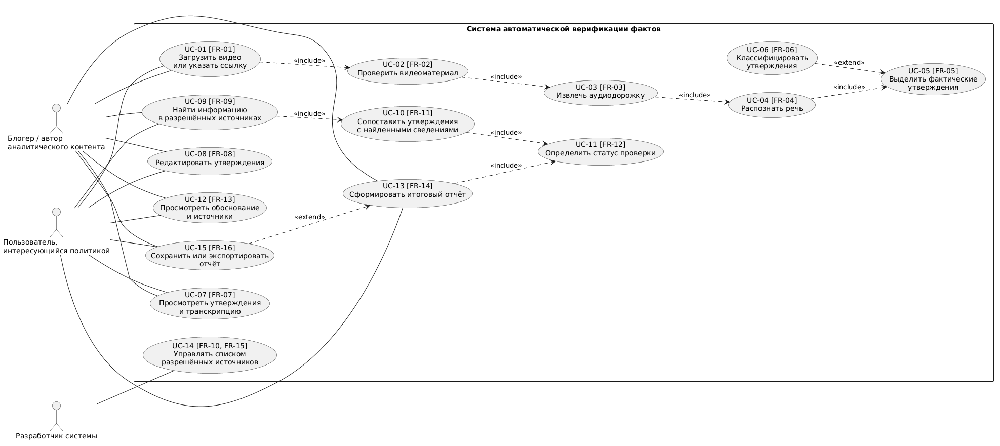

# Лабораторная работа №1. Формулирование требований к программной системе

| Поле | Значение |
|---|---|
| **Студент** | Мурзина Мария Александровна |
| **Группа** | РИС-23-3|
| **Вариант** | Система автоматической верификации фактов политических выступлений |
| **Постановка задачи** | Разработка системы автоматической проверки фактических утверждений в политических видеоматериалах на основе методов обработки естественного языка |
| **Репозиторий** | https://github.com/Solace8595 |
| **Дата сдачи** | 25.11.2026 |

**Тема:** Анализ предметной области и формулирование требований к программной системе.

**Цель работы:** Научиться анализировать поставленную задачу, выделять заинтересованных лиц, формулировать функциональные и нефункциональные требования, представлять результаты в виде диаграммы вариантов использования.

---

## Краткое описание системы

Разрабатываемая программная система предназначена для автоматической проверки фактических утверждений, содержащихся в политических видеоматериалах: выступлениях, интервью, дебатах и новостных роликах. Система позволяет пользователям загружать видеоматериалы или указывать ссылки на них, после чего извлекает аудиодорожку, преобразует речь в текст и выделяет отдельные фактические утверждения с помощью методов обработки естественного языка.  Для проверки утверждений система выполняет поиск информации по заранее определённому списку надёжных информационных источников. Найденные сведения сопоставляются с исходными утверждениями, на основании чего формируется результат проверки с объяснением и ссылками на использованные материалы.

---

## Оглавление

1. Перечень заинтересованных лиц (стейкхолдеров)
2. Перечень функциональных требований
3. Диаграмма вариантов использования
4. Перечень нефункциональных требований
5. Перечень сделанных предположений
   
---

## 1. Перечень заинтересованных лиц (стейкхолдеров)

В рамках разрабатываемой системы выделено пять основных заинтересованных лиц. Основными пользователями являются любые пользователи сети Интернет, заинтересованные в проверке информации из политических видеоматериалов.

| ID | Стейкхолдер | Роль | Интересы / цели | Влияние |
|---|---|---|---|---|
| SH-01 | Разработчик системы (студент) | Автор и разработчик программного продукта | - Разработать систему автоматической верификации фактов из политических выступлений - Реализовать распознавание речи и обработку естественного языка - Обеспечить корректную работу алгоритмов поиска и проверки фактов - Обеспечить соответствие системы поставленным требованиям | Высокое |
| SH-02 | Научный руководитель | Научное руководство проектом | - Разработать систему автоматической верификации фактов из политических выступлений - Реализовать распознавание речи и обработку естественного языка - Обеспечить корректную работу алгоритмов поиска и проверки фактов - Обеспечить соответствие системы поставленным требованиям | Высокое |
| SH-03 | Блогеры и авторы аналитического контента | Использование системы для подготовки обзоров и аналитических материалов | - Анализировать политические интервью, дебаты и выступления - Выделять фактические утверждения из видеоматериалов - Проверять достоверность утверждений перед публикацией собственных материалов - Получать подтверждающие и опровергающие источники. | Низкое |
| SH-04 | Пользователи, интересующиеся политикой | Самостоятельная проверка политической информации | - Проверять достоверность утверждений политиков, журналистов и блогеров - Получать подтверждающие сведения из надёжных источников - Самостоятельно оценивать обоснованность высказываний - Использовать систему без специальных знаний в области фактчекинга | Низкое |

---

## 2. Перечень функциональных требований

Для разрабатываемой системы сформулировано 16 функциональных требований, описывающих основные возможности программного продукта.

Приоритеты определены по методу MoSCoW:

- **Must** — обязательные требования, без которых невозможно выполнение основной задачи системы.
- **Should** — важные требования, которые желательно реализовать.
- **Could** — дополнительные возможности, расширяющие функциональность системы.
- **Won't** — функциональность, которая не планируется к реализации в текущей версии.

| ID | Требование | Стейкхолдер | Приоритет (MoSCoW) | Обоснование |
|---|---|---|---|---|
| FR-01 | Система должна предоставлять пользователю возможность загрузить видеоматериал с локального устройства или указать ссылку на видео. | SH-01 | Must | Необходимо для получения исходных данных для анализа |
| FR-02 | Система должна проверять формат, размер и доступность загруженного видеоматериала. | SH-01, SH-02 | Must | Позволяет исключить обработку неподдерживаемых или некорректных файлов |
| FR-03 | Система должна извлекать аудиодорожку из загруженного видеоматериала. | SH-01, SH-02 | Must | Аудио необходимо для последующего распознавания речи |
| FR-04 | Система должна преобразовывать речь из аудиодорожки в текст с использованием моделей распознавания речи. | SH-01, SH-02 | Must | Полученный текст является основой для дальнейшего анализа |
| FR-05 | Система должна выделять из полученного текста отдельные фактические утверждения. | SH-01, SH-02 | Must | Выделение утверждений является основной функцией системы |
| FR-06 | Система должна классифицировать выделенные утверждения по заранее определённым типам. | SH-01, SH-02 | Should | Классификация позволяет систематизировать информацию и упростить её проверку |
| FR-07 | Система должна предоставлять пользователю возможность просматривать выделенные утверждения и соответствующие им фрагменты транскрипции. | SH-01, SH-03, SH-04 | Must | Необходимо для проверки корректности автоматического выделения |
| FR-08 | Система должна предоставлять пользователю возможность вручную редактировать выделенные утверждения. | SH-01, SH-03, SH-04 | Should | Позволяет исправлять ошибки автоматического анализа |
| FR-09 | Система должна выполнять поиск информации, связанной с проверяемыми утверждениями, только среди заранее определённых информационных источников. | SH-01, SH-02, SH-03, SH-04 | Must | Ограничение поиска позволяет использовать только проверенные информационные ресурсы |
| FR-10 | Система должна хранить и использовать утверждённый список надёжных информационных источников. | SH-01 | Must | Необходимо для ограничения области поиска и контроля качества используемых материалов |
| FR-11 | Система должна сопоставлять проверяемые утверждения с найденными подтверждающими или опровергающими сведениями. | SH-01, SH-02 | Must | Это основной этап автоматической верификации фактов |
| FR-12 | Система должна формировать статус проверки каждого утверждения на основании найденных доказательств. | SH-01, SH-02 | Must | Позволяет представить результат анализа в понятном виде |
| FR-13 | Система должна предоставлять пользователю возможность просматривать обоснование результата проверки и использованные источники. | SH-01, SH-03, SH-04 | Must | Обеспечивает прозрачность и проверяемость результатов |
| FR-14 | Система должна формировать итоговый отчёт по результатам анализа видеоматериала. | SH-01, SH-02 | Must | Позволяет получить обобщённые результаты проверки |
| FR-15 | Система должна предоставлять разработчику возможность добавлять, удалять и изменять информационные источники в утверждённом списке. | SH-01 | Should | Необходимо для актуализации перечня проверенных ресурсов |
| FR-16 | Система должна предоставлять возможность сохранения или экспорта итогового отчёта. | SH-01, SH-03, SH-04 | Could | Позволяет использовать результаты анализа за пределами приложения |

---

## 3. Диаграмма вариантов использования

Для описания взаимодействия пользователей с разрабатываемой системой используется диаграмма вариантов использования (Use Case Diagram), разработанная с помощью PlantUML.

На диаграмме представлены основные участники системы: блогеры и авторы аналитического контента (SH-03), пользователи, интересующиеся политикой (SH-04), а также разработчик системы (SH-01), отвечающий за управление перечнем разрешённых информационных источников.

Диаграмма отражает основные сценарии взаимодействия с системой: загрузку видеоматериалов, обработку речи, выделение и проверку фактических утверждений, просмотр результатов и формирование отчётов.

**Связь с требованиями:** ID соответствующего функционального требования (FR) указан в названии варианта использования (например, `UC-03 [FR-03]`).

### Диаграмма

Исходный код диаграммы: [use-case-diagram.puml](use-case-diagram.puml)

### Описание ключевого сценария

| Поле | Значение |
|---|---|
| **Use Case** | UC-01 [FR-01] Загрузка и анализ видеоматериала |
| **Актор** | Пользователь, интересующийся политикой |
| **Предусловие** | Пользователь открыл систему и имеет ссылку на доступное видео. |
| **Основной поток** | 1. Пользователь указывает ссылку на видео 2. Система проверяет формат, размер и доступность видеоматериала 3. Система извлекает аудиодорожку из видео 4. Система преобразует речь в текст 5. Система выделяет из текста фактические утверждения 6. Система классифицирует выделенные утверждения по заданным типам 7. Пользователь просматривает полученные утверждения и соответствующие фрагменты транскрипции 8. При необходимости пользователь редактирует выделенные утверждения 9. Система выполняет поиск информации по каждому утверждению среди разрешённых источников 10. Система сопоставляет найденные сведения с проверяемыми утверждениями 11. Система определяет статус проверки на основании найденных доказательств 12. Пользователь просматривает результаты проверки, обоснования и использованные источники 13. Система формирует итоговый отчёт по результатам анализа видеоматериала |
| **Постусловие** | В системе сформированы результаты анализа видеоматериала: транскрипция, список фактических утверждений, статусы их проверки, обоснования и ссылки на использованные источники. Итоговый отчёт доступен пользователю для просмотра. |
| **Альтернативный поток** | **А1. Некорректный видеоматериал:** на шаге 2 система обнаруживает неподдерживаемый формат, превышение допустимого размера или недоступность видео и сообщает пользователю об ошибке. **А2. Ошибка распознавания речи:** на шаге 4 система не может преобразовать аудио в текст и сообщает о невозможности продолжить анализ. **А3. Утверждения не обнаружены:** на шаге 5 система не находит фактических утверждений и сообщает пользователю об отсутствии данных для проверки. **А4. Недостаточно информации:** на шаге 11 система не обнаруживает достаточных доказательств и указывает, что утверждение не удалось проверить. |

---

## 4. Перечень нефункциональных требований

Для разрабатываемой системы были рассмотрены следующие категории нефункциональных требований:

- **Performance (Производительность)** — скорость обработки видеоматериалов, выполнения запросов и формирования отчётов.
- **Scalability (Масштабируемость)** — возможность увеличения количества пользователей и объёма обрабатываемых данных.
- **Security (Безопасность)** — защита пользовательских данных, видеоматериалов и результатов проверки от несанкционированного доступа.
- **Availability (Доступность)** — обеспечение стабильной работы системы и минимизация времени её недоступности.
- **Usability (Удобство использования)** — простота и понятность интерфейса для пользователей без специальных технических знаний.
- **Reliability (Надёжность)** — корректная работа системы и сохранение результатов обработки при возникновении ошибок.
- **Maintainability (Сопровождаемость)** — возможность изменять и дополнять программную систему без существенной переработки её архитектуры.
- **Compatibility (Совместимость)** — возможность работы системы в распространённых браузерах и с поддерживаемыми форматами видеоматериалов.

Из рассмотренных категорий выбраны пять наиболее значимых для разрабатываемой системы: Performance, Scalability, Security, Availability и Usability. Остальные категории не включены в итоговую таблицу, поскольку имеют меньший приоритет в рамках текущего проекта.

| ID | Категория | Требование | Метрика / критерий приёмки | Почему выбрано |
|---|---|---|---|---|
| NFR-01 | Performance | Система должна обеспечивать своевременную обработку видеоматериалов и выполнение основных операций: распознавание речи, извлечение фактических утверждений и формирование отчётов. | Время обработки 1 минуты видеоматериала не должно превышать 3 минут при штатной нагрузке. Формирование отчёта по завершённой проверке не должно занимать более 30 секунд. | Производительность особенно важна, поскольку система выполняет несколько последовательных операций обработки видео и анализа текста. Пользователь должен получать результаты за приемлемое время. |
| NFR-02 | Scalability | Архитектура системы должна позволять увеличивать количество одновременно работающих пользователей и обрабатываемых видеоматериалов без существенного снижения производительности. | При увеличении количества одновременно работающих пользователей с 5 до 25 время обработки видеоматериалов и отклика основных API-запросов не должно увеличиваться более чем на 20 % при условии масштабирования вычислительных ресурсов. | Система должна сохранять работоспособность при увеличении числа пользователей и объёма обрабатываемых материалов. |
| NFR-03 | Security | Система должна обеспечивать защиту загружаемых видеоматериалов, пользовательских данных и результатов проверки от несанкционированного доступа. | Все сетевые соединения должны использовать HTTPS; функции управления списком доверенных источников должны быть доступны только разработчику. | Защита данных и ограничение доступа к настройкам необходимы для предотвращения несанкционированных изменений и утечки информации. |
| NFR-04 | Availability | Система должна быть доступна пользователям в течение всего времени эксплуатации, за исключением запланированных технических работ. | Доступность системы должна составлять не менее 99 % в месяц, без учёта заранее объявленных технических работ. | Пользователи должны иметь возможность обращаться к системе и получать результаты проверки без частых перерывов в работе. |
| NFR-05 | Usability | Интерфейс системы должен обеспечивать понятное отображение утверждений, результатов проверки, обоснований и использованных источников. | Не менее 80 % участников тестирования должны самостоятельно находить результат проверки выбранного утверждения не более чем за 3 действия. | Система предназначена не только для специалистов, но и для обычных пользователей, интересующихся политикой. |

---

## 5. Перечень сделанных предположений

Поскольку исходная постановка задачи не определяет некоторые технические и организационные особенности разрабатываемой системы, для дальнейшего проектирования были сделаны дополнительные предположения. Они позволяют конкретизировать требования, определить границы проекта и выбрать подходящие архитектурные решения.

| ID | Предположение | Влияние на требования |
|---|---|---|
| A-01 | Система в первую очередь предназначена для обработки политических выступлений на русском языке. | Определяет выбор модели распознавания речи и методов обработки естественного языка. |
| A-02 | Система должна поддерживать загрузку видеоматериалов в распространённых форматах, например MP4, AVI и MKV, а также обработку видео по доступной ссылке. | Влияет на требования к загрузке файлов, проверке форматов и извлечению аудиодорожки. |
| A-03 | На начальном этапе предполагается использование системы небольшим количеством пользователей, без необходимости обслуживания высокой одновременной нагрузки. | Позволяет ограничить требования к масштабируемости и не предусматривать сложную распределённую архитектуру на первом этапе. |
| A-04 | Для поиска подтверждающей или опровергающей информации используется заранее сформированный список доверенных источников, который может изменяться разработчиком системы. | Определяет необходимость хранения списка источников и реализации функций его добавления, редактирования и удаления. |
| A-05 | Загруженные видеоматериалы, результаты распознавания речи и отчёты должны храниться в системе до удаления пользователем или разработчиком. | Влияет на выбор способа хранения данных и требования к управлению файлами и результатами обработки. |
| A-06 | Система предназначена для информационно-аналитических целей и не заменяет профессиональную юридическую экспертизу или независимую проверку фактов. | Требует отображения источников информации и обоснования результатов проверки, а также предупреждения о возможных ошибках автоматического анализа. |
| A-07 | На первом этапе система разрабатывается как учебный программный продукт без коммерческой модели монетизации. | Позволяет не включать в объём работ реализацию платных подписок, платежей и коммерческих тарифов. |

